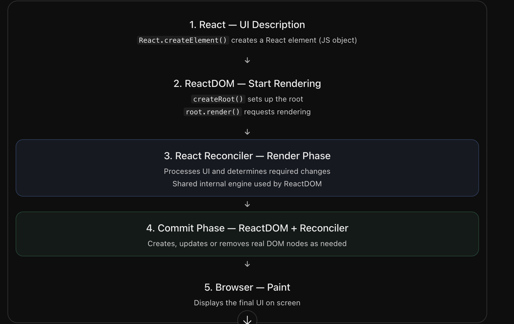

## Episode 1
* Make our own notes
### Part - 1
* google chrome and developer console,vsCode.

#### Emmet
```
it generates code for us
```
* vscode gives smooth experience.
For Example:
```
html:5 generates basic html boilerplate code or html skeleton
```
* We need to write Hello world inside h1 tag after creating div with id root and h1 tag inside div.
```
div#id>h1
```
### Html Code (Hello World!)
```
<!DOCTYPE html>
<html lang="en">
<head>
    <meta charset="UTF-8">
    <meta name="viewport" content="width=device-width, initial-scale=1.0">
    <title>React Teaching</title>
</head>
<body>
    <div id="root">
        <h1>Hello World!</h1>
    </div>
</body>
</html>
```
* Go to developer tools for seeing the code.
* Now we are going to write js "Hello World!" inside the body tag;

### Javascript (Hello World!)
```
<body>
<div id="root"></div>

<script>
  const heading = document.createElement("h1");

  heading.textContent = "Hello World from Javascript";

  document.getElementById("root").appendChild(heading);
</script>
</body>
```
* Browser has already capabilty to execute javascript using v8 engine.

* Browser do not understand react.

#### Homework
What is CDN react?
```
These are the websites, where react library will be hosted and we are fetching that react and pulling into our project using CDN links.
``` 

### React introduction
* Copying CDN links to give react powers to project
```
<!DOCTYPE html>
<html>
  <head>
    <title>React Teaching</title>
  </head>
  <body>
    <div id="root"></div>

<script crossorigin src="https://unpkg.com/react@18/umd/react.development.js"></script>
    <script crossorigin src="https://unpkg.com/react-dom@18/umd/react-dom.development.js"></script>

</script>
  </body>
</html>
```
* Exploring CDN links
#### Homework
* What is crossorigin attribute?

* When we deep dive into first cdn all the code written in js.

* At the end of day,react is a js library written by facebook developers.

* when we write ```React``` in ```console``` and the react code will appear because cdn links injecting react.

* it gives lot of important functions we are going to us which are written in js by the facebook developers.

* we just imported and injected into our project.

### FUN PART 😂 inside React
* 
```
__SECRET_INTERNALS_DO_NOT_USE_OR_YOU_WILL_BE_FIRED
```
### react development.js vs react-dom development.js
* react development.js is core algorithm used for describing and building the UI 
* react-dom(react dependency) development.js bridge between react and browser dom.
* react not only work on browsers ,they can work on mobile phones,react native,react 3d which have different methods and functions etc at different places
* so thats y here react has two files.

```
modify the dom or for dom operations
```
* When we write reactDOM it give directly
```
__SECRET_INTERNALS_DO_NOT_USE_OR_YOU_WILL_BE_FIRED and different methods followed after it
```
* when we use those cdn links we get the super powers of react into our project.

### Part - 2
* We need to write hello world in react.
* we need to create h1 tag inside div tag using react

#### React Code
```
<script>

const heading = React.createElement(
"h1",
{},
"Hello World from react!"
);

const root= React.createRoot(document.getElementById('root'));

root.render(heading);

</script>
```
### React.createElement()
- React.createElement("h1",{},"") has three parameters it is used to create h1 tag here.
```
type
attributes
children
```

- we need to tell the react where is the root,when we need to render the element. 

- here we need to render the h1 tag inside the root id of div.

### ReactDOM.createRoot()

- It comes from the second file react-dom.development.js, because creating a root and rendering something inside is part of react-dom.

- first of all,react need a root where it can do all the dom stuff or dom operations.

- ReactDOM.createRoot() method helps to create root associate with DOM container.

- We need a container for creating root using the above method and where all the dom operations need to done we need some place.

- Here we are using div container with the root and we are taking that element by Id while creating root with the help of ReactDOM.createRoot();

```
ReactDOM.createRoot(document.getElementById('root'));
```
### root.render()
- Now for rendering the heading variable will placed  inside the root
- We use root.render()
```
root.render(heading);
```
- rendering heading inside root.
- It will become dom element after rendering.
- makes render the UI on the webpage by doing essential changes 

### WEB o/p
```
Hello World from React
```

#### Console
* We will see in the console there is a h1 tag inside the div with the text
* We need to write react element
* react element is js object

### Part - 3
* Create App.js file put all the react code into that file.

```
<script>

const heading = React.createElement(
"h1",
{},
"Hello World from react!"
);

const root= React.createRoot(document.getElementById('root'));

root.render(heading);

</script>
```

* In the main index.html file keep 
```
<script src="App.js"></script>
```
* Mostly expensive operation in browser when the webpage is interactive is dom manipulation
```
when the dom nodes to be manipulated i.e DOM Manipulation
```
* Suppose, when we click a button we need to show 

```
something show on to the page
```
or
```
something hide on to the page
```
- Here dom tree is changed continously so it is mostly expensive.

- Simply DOM Operations
```
Putting some nodes on to the DOM
```
or

```
Removing some nodes from the DOM this is costly operation
```
* All the frameworks and libraries trying to optimise this (DOM Manipulation) problem.

* React philosophy is also whenever u do anything in the webpage do it using javascript.
```
your user interface (UI) is just a JavaScript function of your data
```
* so thats y react giving helper functions to make this operation in very efficient way.

### React.createElement()
* Now coming to React.createElement second parameter it used for creating attributes

```
const heading = React.createElement(
"h1",
{id:"heading"},
"Hello World from react!"
);
```
* We can do also styling using that h1 id which we created in the second parameter

* First now we need to create ```index.css``` file for styling h1

```
#heading{
 color:red;
}
```
* But when we log to the console ,we will see the heading as js object.

* So simply here react element is nothing but js object.


##### Heading object in terminal 
```
{
    type:h1,
    props:{
        id:"heading"
        children:"Hello world from react!"
    }
}
```
* props are children and attributes.

* We are passing an react element or js object to render method

* render method take the object and converted into heading tag which understands by browser and put it inside the root container (div what we taken earlier while creating root)

```
ReactElement(object)=>HTML(which browser understands)
```

* simply object converts to dom element which browser understands and put that into dom.
```
Plain JS Object (React Element)  ──▶ 
Real DOM Element (Browser understands)  ──▶  Inserted into the DOM Tree
```

### Part - 4

#### Nested Elements creating using react
```
<div id="parent">
   <div id="child">
      <h1>Hello World!</h1>
   </div>
</div>

```
* Now we are going to nested elements using react like how we created h1.

* the third argument of parent div in createRoot function is used to create inner child div. 
```
<div id="parent">
  <div id = "child">
  </div>
</div>
```
* one more time the child div tag third argument creates element(h1) inside the child div and wrapped inside the child div.

### code
```
const parent = React.createElement("div",
                   {id:"parent"},
               React.createElement("div",
                    {id:"child"},
               React.createElement("h1",{},"Hello World from React!"))
)
console.log(parent)
const root = ReactDOM.createRoot(document.getElementById('root'));
root.render(parent);
```
* Here parent is a object
* more than one child inside a parent we can wrap them in a array.
```
{
    type:'div'
    props:{
        children:[
            type:"div"
            props:{
              id: "child"
              children:"Hello World from React!"
            }
        ]
    }
}
```
* Now we want to create siblings as h2 for h1
```
<div id="parent">
   <div id="child">
       <h1>Hello World from React!</h1>
       <h2>Hello world</h2>
     </div>
 </div>
```
* We will keep array  in the third argumentto create two child elements and we call them as siblings. 
```
const parent = React.createElement("div",
{id:"parent"},
React.createElement("div",
    {id:"child"},
   [
React.createElement("h1",{},"Hello World from React!"),
React.createElement("h2",{},"Hello World !")
  ]),
)
```
* Now a parent div and two child inner divs
```
<div id="parent">
   <div id="child">
       <h1>Hello World from React!</h1>
       <h2>Hello world</h2>
     </div>
     <div id="child2">
       <h1>Hello World from React!</h1>
       <h2>Hello world</h2>
     </div>
 </div>
 ```
 #### Code
 ```
 const parent = React.createElement("div",
                   {id:"parent"},
                 [
                    React.createElement("div",
                    {id:"child"},[
                    React.createElement("h1",{},"Hello World from React!"),
                    React.createElement("h2",{},"Hello World !")
               ]),
               React.createElement("div",
                    {id:"child2"},[
                    React.createElement("h1",{},"Hello  kanna"),
                    React.createElement("h2",{},"Hello Swamy !")
               ])
            ]
               
)
const root = ReactDOM.createRoot(document.getElementById('root'));
root.render(parent);
 ```
* Now we kept array of two divs in the third argument.

* Feeling like tough after seeing the above code ,but jsx makes the job easy.

### Part-5
* Order of file
- Suppose if i keep script which links to above cdn links it will throws reference error.

- diff between react-dom.development.js vs production.min.js

- Suppose we keep h1 tag inside div in the index.html at initial stage.

- But the content will replaced by the content of app.js with the help of react

- (within second we will see the index.html content replaced by parent or app.js while refreshing the page).

- The code will execute line by line synchronously loading react and then reactDOM and then app.js load into webpage 

- Now react control has small part div with id root and render whatever inside it and replaced 

### New experiment
- what if we h1 tag on the above and h2 below of div tag.

- the h1 and h2 contents wont replaced by react and only the content inside div will be rendered and replaced by react.
```
 React can able to work even on small portion of page.
```
For Example,
if we take another element as header using div and while creating root using 
```
reactDom.createroot(document.getElementById('header'))
```
* React will works only on the small portion of header and the content replaced by passing app.js with react.

* Reactjs is a library not a framework
```
Because it can work even on any small portion where framework can comes with all rules and react is just js piece of code written by fb developers.

```
### React flow
