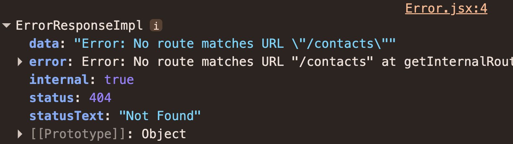

## Episode - 7

### Part - 1

- useEffect different cases

* without using dependency array
* using empty dependency array
* using dependency array with a variable.

### Part - 2

#### Rules when to not write useState

- inside of an if else statement and in loops
- not inside nested functions or event handlers
- outside a function component or custom Hook

#### Best practice

- Try to keep at the top of functional component.

```
Hooks belong at the top level of function components or custom Hooks, before conditional returns.
```

### Part - 3

- Introducing the concept routing.
- For this we use npm javascript library known as react router dom.
- To use that library we must install it and we use below command.

```
npm i react-router-dom
```

- check the installation whether it is present in the package.json along with its latest installed version.

```
npm start or npm run dev
```

- Let us create about us page.

- Whenever we have routes we need to create routing configuration.

- For that, we need to import like below:

```
import {createBrowserRouter} from "react-router-dom";
```

- The `createBrowserRouter ` will create a routing configuration to us.

- now we are developing a appRouter and pass routing configuration inside createBrowserRouter.

```
const appRouter = createBrowserRouter([
  { path: "/", element: <App /> },
]);
```

#### Routing configuration

- The configuration which define what will happen to specific routes

```
The information that tells to browserRouter what will happen on specific path.
```

- like load which element to render on specific path or on which page.

- Here,in the createBrowserRouter contains list of routes.

```
const appRouter = createBrowserRouter([
    {
        path:"/",
        element:<App />
    }
])
```

- Here the Home page or page means component composition thats y we say everything component in react.

- About us is also a component lets create a about us component.

```
const About = () => {
  return (
    <div>
      <p>About</p>
       <h1>Welcome to Kanna's Spicy🌶️🥵</h1>
    </div>

  )
}

export default About
```

- RouterProvider provides the routing configuration to our app

- first we need to import and use in our root.render()

```
import {createBrowserRouter,RouterProvider} from "react-router-dom";
const appRouter = createBrowserRouter([
  {
    path:"/",
    element:<App></App>
  },
  {
    path:"/about",
    element:<About></About>
  }
])

createRoot(document.getElementById('root')).render(
  <StrictMode>
    <RouterProvider router={appRouter} />
  </StrictMode>,
)
```

- The RouterProvider is exported react-router-dom library.

- There are different types of routers and routing modes in react-router-dom library.

#### Recommmended

```
We use createBrowserRouter for this project
```

- Different routers have different usecases.

- Now let we create contact page

```
Contact.jsx
```

- In vscode there is a shortcut to write react component

```
rafce and also we need to download es7+ feature extension
```

- But suggesting not to use and only use when it is necessary.

```
import About from "./pages/About";
import Contact from './pages/Contact.jsx';
import { createBrowserRouter,RouterProvider } from "react-router";
import App from './App.jsx'


const appRouter = createBrowserRouter([
  {
    path:"/",
    element:<App></App>
  },
  {
    path:"/about",
    element:<About></About>
  },
  {
    path:"/contact",
    element:<Contact></Contact>
  }
])

createRoot(document.getElementById('root')).render(
  <StrictMode>
    <RouterProvider router={appRouter} />
  </StrictMode>,
)
```

- `/`-> Home page
- `/about` -> about page
- `/contact` -> Contact us

* If we search extra path or uncreated path after localhost:8000 in the url gives an unexpected error page created by React.

Example:

```
localhost:8000/kanna
```

#### Error page

```
Unexpected Application Error
404 not Found
```

- Now let us create our error page

```
OOPs ! Something went wrong
```

- Now for creating error page(Component) ,we use something known as error element in the routes path configuration within in the home page path.

```
const appRouter = createBrowserRouter([
  {
    path:"/",
    element:<App></App>,
    errorElement:<Error />
  }

])
```

- Now we are going to create Error.jsx

```
const Error = ()=>{
    return(
        <>
        <h1>Oops😅</h1>
        <h2>Something went wrong!😑</h2>
        </>
    )
}
export default Error;
```

- Now when we keep `/kanna or kanna1 or anything` which is not defined in the routes path configuration will results our custom error page.

* But we have a special hook `useRouteError`provided by react-router-dom.

```
import {useRouteError} from "react-router-dom"
```

- It gives more information about the error, we can read the better failure error message in detail using useRouteError hook,instead of only error page.

There are different types of errors right

```
Routefail error
Network error etc.,
```

- We can read the message using useRouteError can show specific detail of the error to user.

- Let we go deep dive into useRouteError

- `useRouteError()` gives us the error caught by the route’s error boundary with the help of react-router-dom, so we can read its details and display an appropriate error message.

- A route’s error boundary shows a fallback component, like `<Error />`, when an error occurs in that route or bubbles up from its child routes.

```
import {useRouteError} from "react-router-dom";
const err = useRouteError()
```

- Now when we log the error to console we will see err variable as object

```
console.log(err);
```


- After clicking down arrow u will see like this as an object in the console.



- react-router-dom is very good in updates and efficient routing mechanism intoducing for every latest version.

- Now Recap and next going to discuss children routes.

### Problem 🙂‍↕️

```
When we go to our about us page where is our header ,footer all😨
```

- so now we have to keep header all over the app and about us page information below header instead of restaurant cards.

- as we move on to the new pages the header will stay on the top of every page and lower portion body will change according to the page.

### Solution

- Next part,we are going to discuss about child routes.

### Part-4

- Everytime we see while rendering the webpage we see header and body if we replace body component and place about component.

- we will get the header on top and about us page below in the place of body.

- Now we need that configuration to all pages so now are going to use children routes.

- children is list of paths and now we move about ,contact pages paths config into children on my parent route or root route.

- On root route we are going to create children and about and contact are children of app.

- Keep the Body component to render in the children route, when using `/` then body will render along with the header using children routes.

```
const appRouter = createBrowserRouter([
  {
    path: "/",
    element: <App></App>,
    children: [
      {
       path:"/",
       element:<Body></Body>
      },
      {
        path: "/about",
        element: <About></About>,
      },
      {
        path: "/contact",
        element: <Contact></Contact>,
      },
    ],
    errorElement: <Error></Error>,
  },
]);
```

- generally we consider component which has header component for rendering the webpage we use it as mainlayout.

- Now import the body to main.jsx and to use the `/` path to render the body component in children route.

### main.jsx

```
import { StrictMode } from "react";
import { createRoot } from "react-dom/client";
import "./index.css";
import About from "./pages/About";
import Contact from "./pages/Contact";
import Error from "./pages/Error";
import Body from "./components/Body/Body.jsx";
import { createBrowserRouter, RouterProvider } from "react-router";
import App from "./App.jsx";

const appRouter = createBrowserRouter([
  {
    path: "/",
    element: <App></App>,
    children: [
      {
       path:"/",
       element:<Body></Body>
      },
      {
        path: "/about",
        element: <About></About>,
      },
      {
        path: "/contact",
        element: <Contact></Contact>,
      },
    ],
    errorElement: <Error></Error>,
  },
]);

createRoot(document.getElementById("root")).render(
  <StrictMode>
    <RouterProvider router={appRouter} />
  </StrictMode>,
);


```

- After configuring child routes in children,Now we need to import `<Outlet />`.It is the place in the parent layout(App.jsx) where React Router renders the matching child route provided by react-router-dom.

### App.jsx

```
import Header from "./components/Header/Header";
import { Outlet } from "react-router";
// import Footer from "./components/Footer/Footer";
import "./index.css"
function App() {

  return (
    <>
      <Header></Header>
      <Outlet></Outlet>
      {/* <Footer></Footer> */}
    </>
  )
}


export default App;
```

- Now the header is intact and attach to every Outlet child route.

- We can create multiple children routes as many as we can.

### Important Point

```
Outlet creates no HTML wrapper, so you won’t see an <outlet> element in the browser’s Elements tab.
```

### Summarised points

```
 Every time based on child route path of the url ,the outlet is replaced by child route component in the main layout.
```

or

```
Loading pages according to outlet
```

### Makes the li items in nav linkable (dynamic)

- Now we are going to create linkable text

For example:

```
clicking on
Home -> Home page
About us -> About us page etc.,
```

- Generally in html we use anchor tag for going one webpage to another webpage.

### Breakthrough

```
Simply reusing the header here
```

- using an anchor tag making full page reload.

### Link Component

- react-router-dom gives link component for routing one page to another page,work like anchor tag but without full page reload when clicking the li text.

```
🤩 Awesome,component only by clicking <Link> changes the route and renders the required component without a full page reload.
```

### Code (Header.jsx)

```
import "./Header.css";
import logoUrl from "../../utils/Urls";
import { useState } from "react";
import { Link } from "react-router";
function Header(){

  const[btnNameReact,setBtnName] = useState("Login")

return (
    <>
      <section className="header">
        <div className="imageContainer">
         
        </div>
        <h1>Spicy Delights😍</h1>
        <nav >
          <ul className="navItems">

            <li>
              <Link to="/">Home</Link>
            </li>
            <li>
              <Link to="/about">About us</Link>
            </li>

            <li>
              <Link to="/contact">Contact us</Link>
            </li>

            <button onClick={()=>{
              btnNameReact === "Login" ? setBtnName("LogOut"):setBtnName("Login");
            }}>{btnNameReact}</button>

          </ul>
        </nav>
     </section>
    </>
)
}
export default Header;
```

### Single Page Application

- Because there are no multiple pages like different types of html files
- In react only component renders instead of whole page reload,Simply only component interchanges whenever necessary(like in outlet).
- That's y it is called Single Page Application.

### Routing

- It is a method to navigate different pages.

There are two types of routing.

```
Client side routing
Server side routing
```

### Client Side Routing

- In this project we are using client side routing ,About and Contact are already imported, so navigating to them doesn’t request a new HTML document.

- Because it has already code for about us ,contact us ,home pages without need for asking code by making a network call to server.

```
When we click about us page it just loads the component or when we moving from one page to another page it just loading required components.
```

### Server Side Routing

```
 If we click on anchor tag (/about ,/index),after that it make(triggers) a network call to server for the document(about.html) and fetches that html file from the server and renders the output to the webpage through full page reload.
```

or

```
Clicking a standard anchor tag (/about, /index) triggers a network request to the server for the new document (e.g., about.html). The server returns the full HTML file, causing the browser to completely reload the page and render the new content from scratch.
```

- The server may return an existing HTML file or generate HTML dynamically. /about does not necessarily mean an about.html file existing in the inbuilt code of web app.

```
It means /about is a URL path,not necessarily a file name.
```

The server can handle it in two ways:

- Existing file:

```
It reads about.html and sends its HTML to the browser.
```

- Generated response:

```
It runs code that creates the HTML and sends it to the browser. No about.html file is needed.
```

- Example when using separate html files

```
Server.html
Index.html
about.html
```

### Breakthrough

```
Server side routing refresh the whole page where it get the code by making a network call to server.
```

or

```
Client side routing refreshes only component where the code is inbuilt and the required code is already loaded in the browser.
```

### Note:

```
Here only network call we made just for api to render the data for restaurant cards not for pages like about us,Contact us etc.,
```

### Part-5

* Now we are going to develop a feature when we click a restaurant card,it will routes to new web page.

* In that page ,restaurant card is with menu items below restaurant image.

* Here for every restaurant card has dynamic route

* On clicking dynamic route make api call,which will made to fetch the data of api of that particular restaurant card along display with restaurant menu.

### Task
* Making the dynamic routes for all restaurant cards

* Makes the problem into different things

* Now we will just create Restaurantmenu.jsx and loading on to some route.

* It is nothing but RestaurantMenu component i.e. Restaurantmenu page.

#### Dynamic Routing
Dynamic routing means using one route pattern to handle multiple similar pages by changing a value in the URL.

Example:
```
/restaurant/101
/restaurant/205
/restaurant/450
```
* Now let we create one sample dynamic child route for default RestaurantMenu instead of every restaurant card.

```
children :{
  path:"/restaurant/:restaurantId"
  element:{<RestaurantMenu />}
}
```
- `/restaurant/:resId`-` :`-> this colon  here describes `resId` as dynamic URL parameter . Whatever number or text we type(any value) in that position matches the route .So,react-router-dom will render immediately `<RestaurantMenu>` component at instant.

```
/restaurant/123
/restaurant/abc
/restaurant/paradise immediatley render RestaurantMenu
```

### Problem
```
 Still it is not dynamic,it is just rendering default Restaurantmenu  instead of dynamic routing for every card and appear menu of that card according to it.
 ```

### Solution
- useParams() to get the id dynamically from the url for dynamic routing.

```
A ternary operator works in JSX conditional rendering. If an error occurs, check the expression, JSX syntax, and data being accessed.
```

- useParams for dynamic routing as resId
- static routing vs dynamic routing
